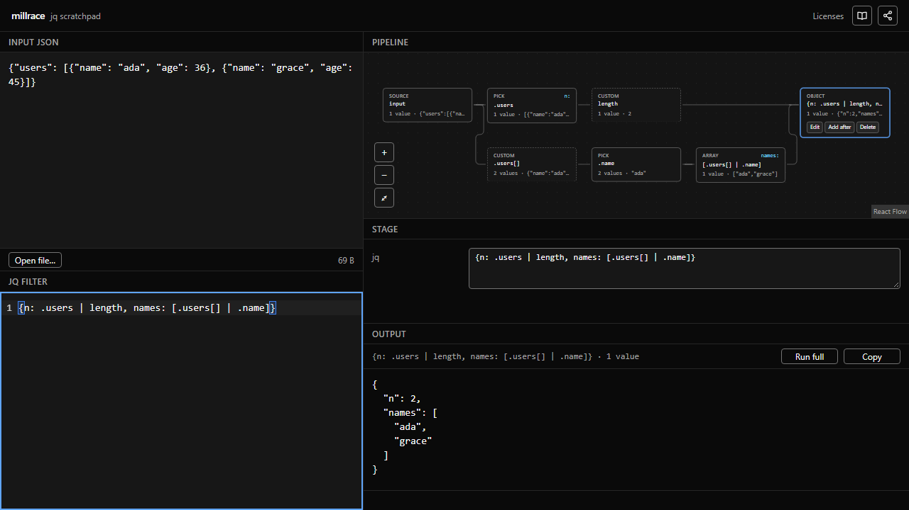
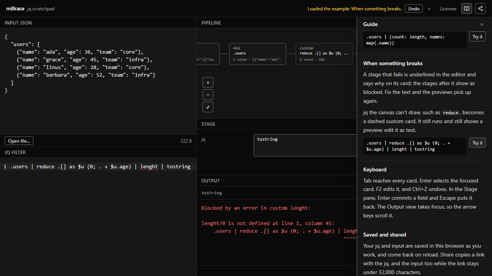

# millrace

A browser-only scratchpad for working out JSON transforms with jq. Paste a JSON
payload, build the transform as jq text or as a node graph, see the data after
every stage, and copy out real jq you can run anywhere.



The graph and the jq text are two views of the same program, and editing either
one updates the other. The graph is only there to help you write the jq; the jq
is what you take away.

There's no backend and no account. The app is static files, and your data never
leaves the browser.

## What it does

- **A preview at every stage.** Each `|` stage is a card showing what it
  outputs. Select a card to see its full output. **Run full** runs the whole
  program on the whole input.
- **Edit on either side.** Type jq in the editor, or edit a stage on the canvas:
  edit it in place, add a stage after it, delete it, or change its fields in
  the Stage pane. A canvas edit changes only that stage's text, so your spacing
  and comments survive, and **Ctrl+Z** undoes canvas edits and typing alike.
- **Objects fan out.** `{count: length, names: map(.name)}` draws a lane for
  each key, each lane previewed stage by stage.
- **Errors where they happen.** A compile error is underlined in the editor and
  named on the failing card, and the stages after it show as blocked.
- **Never rejects valid jq.** Anything the canvas can't draw (`reduce`, `def`,
  `label`, ...) becomes a custom card that still runs and still previews.
- **Real jq.** Previews come from jq 1.8.2 compiled to WebAssembly, so what you
  see is what `jq` prints.
- **Big inputs.** A 50 MB input stays responsive: previews run on a sample
  (arrays cut to 200 items), and output is drawn a screenful at a time.
- **Saved and shared.** Your jq and input are saved in the browser as you work.
  **Share** copies a link holding the jq, and the input too while it fits. The
  link keeps them in the URL fragment, which is never sent to a server.
- **A built-in guide.** The book icon opens a guide to the app. Each section's
  **Try it** button loads an example, and Undo brings your own document back.
- **Accessible.** You can work the canvas from the keyboard, focus is always
  visible, and contrast meets WCAG 2.2 AA (checked by axe in the end-to-end
  tests).



## How it works

A few rules hold the design together:

1. **The jq text is the only state.** The parse tree is derived from the text,
   the graph from the parse tree, and the canvas draws the graph. There is no
   second model of the pipeline to keep in sync.
2. **A graph edit is a text splice.** Editing a card replaces just that stage's
   range in the text. The program is never regenerated from a syntax tree,
   which would lose your formatting and comments.
3. **Undo is the editor's history.** Since every graph edit is a text change,
   CodeMirror's undo covers both views. There is no separate undo stack.
4. **Each preview reuses the one before it.** Stage *k* runs on stage *k−1*'s
   cached output, one jq call per stage. An edit recomputes the edited stage
   and everything after it; the stages before it come from the cache.
5. **jq runs in a Web Worker,** so the canvas stays smooth while a filter runs.
   A filter that runs away is stopped by a timeout.

## Stack

- [Vite](https://vite.dev), React 18, TypeScript (strict)
- [React Flow](https://reactflow.dev) for the canvas
- [CodeMirror 6](https://codemirror.net) for the editor
- [web-tree-sitter](https://github.com/tree-sitter/tree-sitter) with
  [tree-sitter-jq](https://github.com/flurie/tree-sitter-jq) for parsing, with
  error recovery
- jq 1.8.2 as WebAssembly ([jq-wasm](https://www.npmjs.com/package/jq-wasm)),
  in a worker via [comlink](https://github.com/GoogleChromeLabs/comlink)
- Zustand, Tailwind CSS, Radix UI
- Vitest and Playwright (with axe) for tests

## Getting started

You need Node.js 20 or later.

```sh
npm install      # also patches jq-wasm's memory cap (see below)
npm run dev      # http://localhost:5173
```

To build and serve the production build:

```sh
npm run build    # type-checks, then builds into dist/
npm run preview
```

`dist/` is a static site: any static host can serve it as is.

## Scripts

| Command | What it does |
| --- | --- |
| `npm run dev` | Vite dev server |
| `npm run build` | Type-check, then production build |
| `npm run preview` | Serve the built `dist/` |
| `npm run typecheck` | Type-check the whole project |
| `npm run lint` | ESLint, failing on any warning |
| `npm test` | Unit tests (Vitest) |
| `npm run test:e2e` | End-to-end tests (Playwright) against a production build |
| `npm run build:grammar` | Rebuild the jq grammar's wasm (needs git and network) |

Before the first end-to-end run, install Playwright's browser once with
`npx playwright install chromium`.

## Project layout

```
src/
  core/        pure logic, no React or DOM; where the tests are
    parse/     jq text -> parse tree -> graph model
    splice/    graph edits -> text replacements
    eval/      the preview cache, dirty marking, sampling, error placement
    persist/   share-link encoding
    guide/     the guide's sections and examples
  ui/          React components
  worker/      the jq WebAssembly host
e2e/           Playwright tests
scripts/       jq-wasm patch, grammar build, license notices
```

## Testing

- **Unit tests** (`src/core`, `src/worker`) cover the three parts that keep
  the app correct:
  - Round trip: a no-op edit spliced back gives byte-identical text, comments
    and whitespace included.
  - Projection: given jq text, the graph has the expected shape, and the cases
    the canvas can't draw fall back to custom cards.
  - Cache invalidation: editing stage 3 of 6 recomputes stages 3 to 6 and
    leaves 1 and 2 cached.

  Every example in the jq manual runs through the engine too, as does every
  example in the guide.
- **End-to-end tests** (`e2e/`) drive the production build in Chromium:
  - editing on the canvas, fan-out, sharing and persistence, the guide;
  - a 50 MB paste that must never block the page for long;
  - axe and contrast checks;
  - a layout test that fails if a preview update moves anything.

## Limits

- jq's heap is capped at 1 GB. jq-wasm's stock cap of 256 MB handles only
  about 20 MB of input, so `npm install` patches it (`scripts/patch-jq-wasm.mjs`).
- jq can't be interrupted mid-run. A preview that runs over 10 seconds (60
  seconds for Run full) is stopped by replacing the worker.
- Previews run stage by stage on a sample, so they can differ from the whole
  program where a later stage reads `input`/`inputs` or `$__loc__`. Run full
  always gives jq's exact answer.
- In the browser, `$ENV` is a placeholder environment, and modules
  (`import`/`include`) can't be loaded.

## License

[MIT](LICENSE) © 2026 Gaurav Gondane

Built on [jq](https://jqlang.org) (MIT) and
[tree-sitter-jq](https://github.com/flurie/tree-sitter-jq) (BSD-3-Clause),
among others, each under its own license. Production builds include
`licenses.txt`, linked from the app's header, with the notices of everything
bundled.
